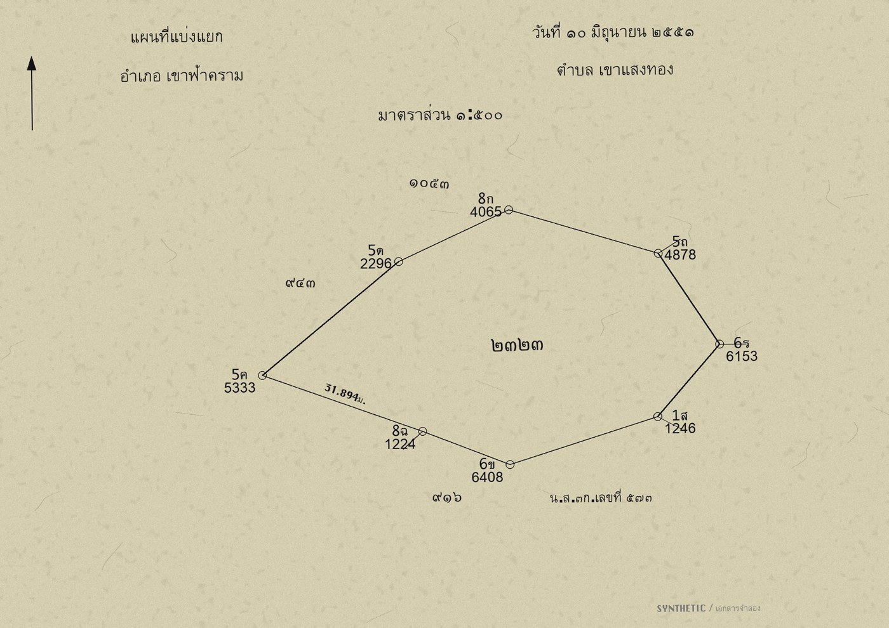

# Land Document AI

Finds and reads **parcel numbers** (เลขที่ดิน) on Thai land survey maps and title deeds.

> **Learning prototype. Not for deciding ownership, and not for data entry without a person checking every value.**
> Every image in this repository is synthetic. Not affiliated with any government agency.
> Do not post real deeds or personal data in issues or pull requests.

**Status:** about 97.5% recall and precision on unseen synthetic maps, but **not usable on real deeds yet**
(see [Real deeds](#real-deeds)).



## How it works

```
deed image
  -> crop the map, using printed form words (Apple Vision)
  -> YOLO-OBB finds rotated boxes in 6 classes: parcel, struck, marker, length, area, text
  -> each parcel number is cut out and rotated upright
  -> a small CRNN reads it (Thai ๐-๙ or Arabic 0-9, never a mix)
  -> compared with the parcel-number field in the deed header
  -> a person checks the image and types the final number
```

Real maps mix numeral systems on one sheet, so "any 1-4 digit number" is not a usable rule. These patterns,
taken from four real images, shaped the synthetic data:

| Item | Written in |
|---|---|
| Parcel number | Thai digits (a share of Arabic pages is an assumption) |
| Boundary marker | Arabic digits plus a Thai letter on two lines, e.g. `3ก` / `8580` |
| Length | Arabic digits |
| Area (rai-ngan-wa), scale | Thai digits |

## Run the prototype (macOS only)

```bash
uv venv --python 3.13 .venv && uv pip install --python .venv/bin/python -r requirements.txt
swiftc -O vision_ocr.swift -o vision_ocr
.venv/bin/python app.py                         # http://127.0.0.1:8765
```

Installing from scratch with `requirements.txt` has not been tested. macOS is required because form fields are
located with Apple Vision.

- **Nothing is pre-filled.** On one real deed the header and the map were read the same way and both were wrong.
- It listens on `127.0.0.1` only. The uploaded page stays in memory and is not written to disk by the server,
  except for a temporary copy used while Apple Vision runs, which is then removed.
- If consent is ticked, only the crop of the number and the confirmed value go to `feedback/` for later fine-tuning.
- **Do not expose it to the internet:** there is no login and no HTTPS.

## Results

Right means every digit of the number is right. Page types: **S** single parcel, printed; **H** single parcel,
simulated old handwriting; **P** subdivision, printed; **Q** old dense subdivision.

### Final test: 200 unseen synthetic pages

New offices and fonts used nowhere else, never viewed, measured once (`results/test2.json`).

| 7,123 parcel numbers | Recall | Precision | F1 |
|---|---|---|---|
| Find (YOLO) | 99.93 | 99.92 | 99.92 |
| **Find and read** | **97.50** | **97.49** | **97.49** |

All numbers on the page right: 73.5% of pages (S 100, H 92, P 96, **Q 6**).

After this measurement the reader was changed to never mix Thai and Arabic digits in one number. On validation
that moved accuracy from 95.77 to 95.75; the final test was not run again.

### From baseline to current model: 120 validation pages, 4,331 numbers

| Read correctly (%) | S | H | P | Q | All |
|---|---|---|---|---|---|
| A: Apple Vision, whole page | 91.2 | 84.9 | 72.2 | 26.6 | 40.7 |
| B: Apple Vision, tiles | 91.2 | 82.5 | 79.0 | 36.8 | 49.4 |
| YOLO + Apple Vision | 91.2 | 81.7 | 94.5 | 61.8 | 70.7 |
| **YOLO + our reader** | 100 | 100 | 100 | 94.1 | **95.8** |

None of these rows uses the registry. Validation was used to pick the YOLO weights, the reader epoch and the
reading direction, and it comes from the same generator as training, so these scores are optimistic.

### Real deeds

Counted by eye on the three real images where the truth could be read (whole page, best-looking scale per image):

| | Recall | Precision |
|---|---|---|
| Find | 5/7 | 5/17 |
| Find and read | 2/7 | 2/17 |

- Too few images for percentages, and the images were seen while parts of the system were being designed.
- Best case: on one sharp scan (1,276 px wide) all 14 boundary markers and all 4 parcel numbers in the map were found, and 2 of the 4 were read correctly.
- Cropping to the map removed the false parcel numbers on the two deeds tried, but lost one true number.
- Images 600-850 px wide did not work.
- A wrong reading had a confidence of 0.97, so **confidence must not be used to skip human review.**

### Baselines without training: synthetic test, Thai-numbered pages

12,407 numbers on 349 pages (`results/baseline_v2.json`):

| Read correctly (%) | S | H | P | Q | All |
|---|---|---|---|---|---|
| A: whole page | 97.6 | 93.4 | 74.2 | 39.2 | 50.7 |
| B: 480 px tiles, enlarged 2x | 92.6 | 87.5 | 82.6 | 52.2 | 61.6 |

With B, 19.6% of the numbers were not found and 18.8% were found but misread. Treating any 1-4 digit number as a
parcel number was right 35% of the time; requiring all-Thai digits, 85%.

## Files

| File | Purpose |
|---|---|
| `app.py`, `app.html`, `pipeline.py` | Local review app and the full pipeline |
| `docs/`, `export_onnx.py` | Browser demo: both models as ONNX, run with onnxruntime-web (MIT). No server, the image stays in the browser. Try it with `python3 -m http.server 8770 --bind 127.0.0.1 --directory docs` |
| `best.pt`, `ocr_thai.pt` | Trained YOLO-OBB and digit reader (0.9M parameters) |
| `generate_v2.py` | Synthetic maps with ground truth (uses helpers from `generate.py`) |
| `prepare_yolo.py`, `colab/train_yolo_obb.ipynb` | Build the YOLO dataset and train on Colab |
| `ocr_data.py`, `train_ocr.py` | Build reader images and train the reader |
| `yolo_tiles.py`, `read_numbers.py` | Tiled detection and number reading |
| `final_metrics.py`, `score_yolo.py`, `evaluate.py` | Scoring |
| `run_v2.py`, `crop_variants.py`, `vision_ocr.swift` | Apple Vision baselines |
| `run_baselines.py` | First version (v1), no longer used |

## Rebuild the data

```bash
python3 generate_v2.py --out data_v2 --per-office 200                    # about 8 min on an M2, 1.1 GB
python3 generate_v2.py --out data_v2 --per-office 100 --offices 11-12    # final test set, 129 MB
```

Needs numpy, pillow and scipy. Pages are split by office: train 1-6 (1,200), val 7-8 (400), test 9-10 (400),
final test 11-12 (200). Digit fonts differ between splits, and some come from `~/Library/Fonts`
(Anuphan, ChulaCharas, CHULALONGKORN, SF Pro TH). The script stops and names any missing font; other fonts give different images.

## Next steps, once real data with consent exists

1. Collect real handwritten numbers with the prototype, and hold out a test set split by deed.
2. Write a script that fine-tunes `ocr_thai.pt` on them mixed with synthetic images (not written yet).
3. Add deed forms, ornamental borders, seals and overlaid numbers to the generator, then retrain YOLO.
4. Save box positions in the prototype, so YOLO can be fine-tuned too.
5. Measure on hundreds of real deeds before considering any automatic approval.

## Limitations

- Almost all results are on synthetic images. They compare methods; they do not predict accuracy on real deeds.
- Simulated handwriting comes from warped fonts and redrawn glyph outlines, not from people.
- Vertical numbers make up 41% of synthetic parcel numbers, probably more than in reality.
- The reader was trained on 1-4 digit numbers only, and is not measured on markers, lengths or areas.
- The target parcel is guessed as the number nearest the middle of the boundary markers. This guess has not been measured.
- The test split of offices 9-10 is not clean: 8 pages were run while debugging, some were viewed while fixing the
  generator, and one crop variant's test score was seen before selection. Offices 11-12 were made for that reason.

## License

[AGPL-3.0](LICENSE). `best.pt` was trained with Ultralytics (AGPL-3.0), starting from weights pretrained on DOTAv1,
whose images and annotations are limited to academic use. Check both before any commercial use.
